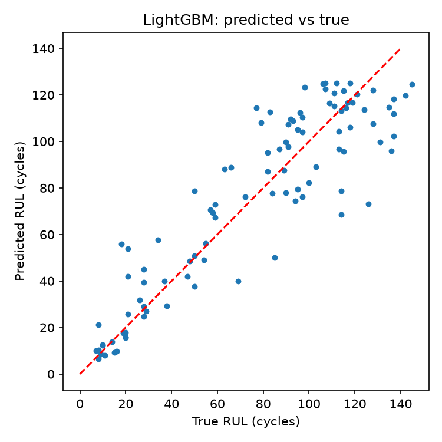
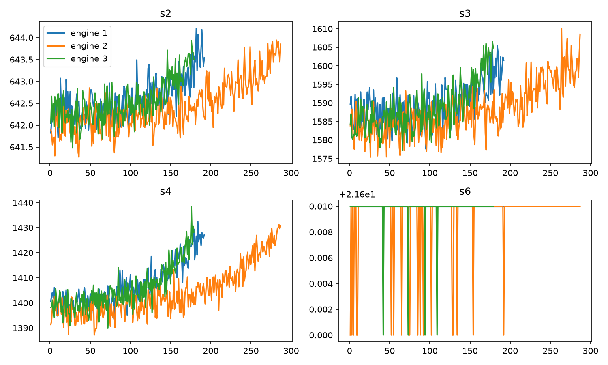

# Engine RUL Monitor

Predicts the remaining useful life (RUL) of jet engines from sensor data (NASA C-MAPSS FD001) and turns the predictions into maintenance alerts, shown on an interactive 3-page React dashboard.

**Stack:** Python, pandas, scikit-learn, LightGBM, matplotlib | React 18, JavaScript, HTML, CSS (canvas animation, no build step)

## Results (100 held-out test engines)

| Model | Test RMSE (cycles) |
|---|---|
| Mean baseline | 43.1 |
| Linear regression | 21.7 |
| **LightGBM** | **17.8** (58.8% better than baseline) |

**Maintenance alert** (flag engines predicted under 30 cycles left): caught 19 of 25 truly at-risk engines (76% recall) with 95% precision and 1 false alarm.

## Dashboard

- **Overview:** animated turbofan whose spin and colour follow engine health, headline metrics, live alert ticker
- **Fleet:** health grid of all 100 engines, engine detail gauge, adjustable alert threshold with live recall and false-alarm counts
- **Model:** predicted vs true chart and model comparison

Add your screenshots here: `images/overview.png`, `images/fleet.png`, `images/model.png`

## Method

1. Built the RUL target (last cycle minus current cycle) and capped it at 125, since early-life sensors barely change
2. Dropped 6 flat sensors, kept 15
3. Added 15-cycle rolling mean and standard deviation per sensor, per engine
4. Split by engine (80 train / 20 validation) so no engine appears in both sets
5. Compared mean baseline, linear regression and LightGBM
6. Tested on the last recorded cycle of each test engine against `RUL_FD001.txt`
7. Converted predictions into alerts and measured recall, precision and false alarms

## Run it

    pip install -r requirements.txt
    # put train_FD001.txt, test_FD001.txt, RUL_FD001.txt in data/
    python src/train.py                    # writes web/results.json
    cd web && python -m http.server 8000   # open http://localhost:8000

## Notes

C-MAPSS is simulated data, so results show the method works on benchmark data, not on real fleet performance.
